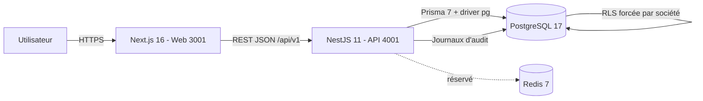

# NEXUS ERP — Cahier des charges et stack technique

**Version :** 1.0  
**Date :** 5 novembre 2026  
**Périmètre :** état réellement implémenté dans le dépôt `nexus-erp`  
**Statut :** application ERP multi-entreprises fonctionnelle, non prête pour une mise en production publique

---

## 1. Contexte et objectif

NEXUS ERP est une application SaaS de gestion d'entreprise multi-sociétés destinée aux PME marocaines et internationales. Elle centralise l'identité, les sociétés, les rôles, le stock, la relation client, les ventes, la facturation, les encaissements et le pilotage exécutif.

L'objectif du projet est de fournir un socle ERP :

- multi-tenant, avec isolation stricte des données par société ;
- sécurisé par authentification, permissions et journal d'audit ;
- piloté par des données réelles de la base, sans données simulées dans le tableau de bord ;
- utilisable sur desktop et mobile, en thème clair et sombre ;
- extensible vers les achats, la comptabilité générale, les RH, les projets et le reporting avancé.

### 1.1 Objectifs mesurables

| Objectif | Critère d'acceptation |
| --- | --- |
| Isolation multi-tenant | Aucune lecture/écriture inter-société possible, y compris via l'API ; RLS PostgreSQL forcée |
| Sécurité des accès | Toute route métier exige une session valide et une permission du rôle actif |
| Tableau de bord fiable | 100 % des KPI, graphiques et widgets proviennent de la base de la société active |
| Parcours de vente complet | Devis → commande → livraison → facture → paiement, avec stock et écritures comptables |
| Qualité | `typecheck`, tests unitaires, tests d'intégration PostgreSQL et build de production passent |
| Expérience utilisateur | Responsive de 320 px à 1440 px, sans débordement horizontal, thèmes clair/sombre |

---

## 2. Stack technique

### 2.1 Vue d'ensemble

| Couche | Technologie | Version | Rôle |
| --- | --- | --- | --- |
| Monorepo | pnpm workspace | pnpm 10.34.9 | Gestion des applications et du package partagé |
| Runtime | Node.js | ≥ 22.18 (24.11 recommandé) | Exécution API et outils |
| Frontend | Next.js (App Router) | 16.4.5 | Application web, routage, rendu |
| Frontend | React / React DOM | 19.2.3 | Interface utilisateur |
| Frontend | TypeScript | 5.9.3 | Typage statique |
| Frontend | CSS personnalisé | — | Design system maison, thèmes, responsive (pas de Tailwind/shadcn) |
| Graphiques | SVG natif | — | Graphiques sans dépendance externe |
| Backend | NestJS | 11.2.8 | API REST modulaire |
| Backend | TypeScript | 5.9.3 | Typage statique |
| Backend | Prisma ORM | 7.10.1 | Accès aux données, migrations, seed |
| Backend | `@prisma/adapter-pg` + `pg` | 7.10.1 / 8.16.3 | Adaptateur PostgreSQL |
| Base de données | PostgreSQL | 17 (image `postgres:17-alpine`) | Persistance, RLS, contraintes |
| Cache / files | Redis | 7 (image `redis:7-alpine`) | Réservé aux phases ultérieures, non requis aujourd'hui |
| Auth | Sessions opaques + cookie | — | Cookie HttpOnly, hash SHA-256 en base |
| Mots de passe | Argon2id (`argon2`) | 0.44.0 | Hachage des mots de passe |
| Validation | `class-validator` / `class-transformer` | 0.14.2 / 0.5.1 | Validation et transformation des DTO |
| Validation | Zod | 4.1.12 | Validation de configuration / données |
| Sécurité HTTP | Helmet | 8.1.0 | En-têtes de sécurité |
| Limitation de débit | `@nestjs/throttler` | 6.5.0 | Protection contre les abus |
| Documentation API | `@nestjs/swagger` | 11.2.6 | OpenAPI / Swagger UI |
| Tests | Jest + ts-jest | 30.2.0 / 29.4.5 | Tests unitaires et d'intégration |
| Conteneurs | Docker Compose | — | PostgreSQL, Redis, API et web optionnels |
| CI/CD | GitHub Actions | — | Workflows présents dans `.github` |

### 2.2 Organisation du dépôt

```text
nexus-erp/
├── apps/
│   ├── api/                 # API NestJS + Prisma + migrations + seed + tests
│   └── web/                 # Application Next.js (App Router)
├── packages/
│   └── shared/              # Types publics, locales et devises partagés
├── infra/
│   └── docker/              # Rôles PostgreSQL, Dockerfiles API/web
├── docs/                    # Roadmap, décisions d'architecture, statut, ce document
├── docker-compose.yml
├── pnpm-workspace.yaml
└── package.json
```

### 2.3 Architecture applicative



- **Web** : rendu Next.js, appels à l'API via `NEXT_PUBLIC_API_URL`, aucune donnée métier codée en dur.
- **API** : préfixe global `/api/v1`, validation stricte des entrées, Swagger sur `/api/docs`.
- **Base** : PostgreSQL partagé avec clé tenant `company_id` et politiques RLS `FORCE ROW LEVEL SECURITY`.
- **Rôles PostgreSQL** :
  - `nexus_app` : rôle runtime, non propriétaire, sans `BYPASSRLS` ;
  - `nexus_migrator` : rôle de migration, distinct du runtime.

### 2.4 Environnement de développement

| Service | URL / valeur |
| --- | --- |
| Application web | `http://localhost:3001` |
| API | `http://localhost:4001/api/v1` |
| Santé API | `http://localhost:4001/api/v1/health` |
| Documentation OpenAPI | `http://localhost:4001/api/docs` |
| PostgreSQL | `127.0.0.1:5432`, base `nexus_erp` |
| Redis | `127.0.0.1:6379` (optionnel) |

Variables principales : `DATABASE_URL`, `MIGRATION_DATABASE_URL`, `API_PORT`, `WEB_ORIGIN`, `NEXT_PUBLIC_API_URL`, `SESSION_COOKIE_NAME`, `SESSION_TTL_HOURS`, `COOKIE_SECURE`, `DEMO_USER_EMAIL`, `DEMO_USER_PASSWORD`.

> Le `README.md` mentionne encore les ports 3000/4000 ; les valeurs actives du projet et du `.env.example` sont **3001/4001**.

---

## 3. Périmètre fonctionnel

### 3.1 Inclus dans l'état actuel

1. Identité et authentification.
2. Gestion multi-sociétés et changement de société active.
3. Rôles, permissions et administration des membres.
4. Tableau de bord exécutif alimenté par la base.
5. Inventaire et entrepôts.
6. CRM (clients, prospects, opportunités, activités).
7. Ventes (devis, commandes, livraisons, factures, paiements).
8. Comptabilité de support des ventes (comptes, journaux, lignes équilibrées).
9. Recherche globale, centre de notifications, audit.
10. Interface responsive, thèmes clair/sombre.

### 3.2 Hors périmètre actuel

- Achats et fournisseurs.
- Comptabilité générale complète, rapprochement bancaire, clôtures.
- Paie et RH.
- Projets.
- Application mobile native.
- Envoi réel d'e-mails (les liens sont exposés en développement uniquement).
- MFA, invitations de membres, fournisseur de paiement.
- Marketing public complet (tarifs, contact, démo).
- Localisation complète EN/AR et RTL.
- Opérations de production (HTTPS, sauvegardes, supervision, facturation SaaS).

---

## 4. Acteurs et rôles

### 4.1 Acteurs

| Acteur | Description |
| --- | --- |
| Visiteur | Accède à la page publique, à la connexion et à l'inscription |
| Utilisateur authentifié | Possède une session et une ou plusieurs appartenances à des sociétés |
| Membre d'une société | Disposé d'un rôle dans la société active |
| Propriétaire / administrateur | Gère la société, les rôles et les membres |
| Équipe commerciale | Gère CRM, devis, commandes, factures et paiements |
| Équipe stock | Gère articles, entrepôts, réceptions et transferts |
| Comptable | Consulte et exploite les données de ventes et finances |
| Direction | Consulte le tableau de bord exécutif |

### 4.2 Rôles système seedés

| Rôle | Portée |
| --- | --- |
| Company Owner | Tous les modules sauf `platform` |
| Company Admin | Tous les modules sauf `platform` |
| General Manager | Société, stock, ventes, achats, finance, RH, CRM, projets, rapports, notifications |
| Accountant | Finance, ventes, achats, rapports |
| HR Manager | RH, rapports |
| Sales Manager | Ventes, CRM, rapports |
| Inventory Manager | Stock, achats, rapports |
| Employee | Société et notifications en lecture |

Les permissions sont construites sur 12 modules (`platform`, `company`, `inventory`, `sales`, `purchasing`, `finance`, `hr`, `crm`, `projects`, `reports`, `notifications`, `administration`) et 7 actions (`create`, `read`, `update`, `delete`, `approve`, `export`, `manage`), soit 84 clés `module.action`. Des rôles personnalisés peuvent être créés par société.

---

## 5. Exigences fonctionnelles détaillées

### 5.1 Authentification et sessions

- Inscription avec nom, e-mail, mot de passe et création transactionnelle de la société, du rôle propriétaire, des permissions, de l'abonnement d'essai et de l'événement d'audit.
- Connexion par e-mail/mot de passe, mot de passe haché en Argon2id.
- Session opaque : jeton aléatoire en cookie `HttpOnly`, `SameSite=Lax`, `Secure` configurable ; seul le hash SHA-256 est stocké.
- Vérification d'e-mail par jeton à usage unique, haché et expirable.
- Réinitialisation de mot de passe par jeton à usage unique ; la réinitialisation révoque les sessions actives.
- Liste et révocation des sessions actives.
- Déconnexion.
- `GET /auth/me` ne retourne que les appartenances actives.
- En développement uniquement, les liens de vérification/réinitialisation sont renvoyés dans la réponse ; jamais en production.

### 5.2 Sociétés et changement de contexte

- Liste des sociétés de l'utilisateur.
- Création d'une nouvelle société avec provisionnement transactionnel.
- Sélection de la société active stockée sur la session, après vérification de l'appartenance active.
- Lecture et mise à jour du profil de la société : nom, raison sociale, pays, devise, langue, fuseau horaire, mois de début d'exercice.
- Toute modification est soumise aux permissions et journalisée dans l'audit.

### 5.3 Rôles, permissions et membres

- Liste des permissions disponibles.
- Liste des rôles de la société active.
- Création de rôles personnalisés.
- Remplacement des permissions d'un rôle personnalisé.
- Listing des membres.
- Affectation d'un rôle à un membre.
- Les rôles système sont protégés contre la modification.

### 5.4 Tableau de bord exécutif

Le tableau de bord est la vue d'accueil après connexion. Il est autorisé par `reports.read` et filtre chaque bloc selon les permissions métier (`sales.read`, `crm.read`, `inventory.read`, `finance.read`).

**Filtres de période :** 7 jours, 30 jours, 90 jours, 6 mois, 12 mois, année en cours.

**KPI (données réelles) :**

| KPI | Source |
| --- | --- |
| Chiffre d'affaires | Somme des `subtotal` de factures non annulées sur la période |
| Volume de ventes | Somme des `total` de commandes non annulées |
| Commandes | Nombre de commandes non annulées |
| Commandes en attente | Statuts `OPEN`, `PARTIALLY_DELIVERED`, `DELIVERED`, `PARTIALLY_INVOICED` |
| Factures impayées | `total - paidAmount` des factures `OPEN` / `PARTIALLY_PAID` |
| Clients | Clients actifs + prospects actifs en légende |
| Produits | Articles actifs |
| Valeur du stock | Quantité disponible × coût unitaire |
| Stock faible | Articles actifs sous ou au point de réapprovisionnement |
| Dépenses | Débits nets des lignes comptables `EXPENSE` validées ; « Non configuré » si absent |

**Graphiques :**

- Chiffre d'affaires dans le temps.
- Performance commerciale (facturé vs encaissé).
- Commandes par statut.
- Dépenses mensuelles.
- Top produits.
- Répartition du stock par entrepôt.
- Croissance clients / prospects.

**Widgets :**

- Dernières ventes / factures.
- Dernières commandes.
- Derniers clients.
- Alertes de stock faible.
- Factures en attente.
- Suivi CRM à venir.
- Notifications.
- Actions rapides filtrées par permissions.

**Autres fonctions :**

- Recherche globale debounced (clients, prospects, articles, devis, commandes, factures, pages).
- Centre de notifications avec compteur non-lu, sévérités, marquage lu / tout lu, stockage par société.
- Sélecteur de société.
- Fil d'Ariane.
- Thème clair/sombre persistant.
- Sidebar repliable avec état persistant.
- Menu profil et déconnexion.

> Le bénéfice net n'est pas affiché : il nécessitera un suivi fiable du coût des marchandises vendues (COGS), non disponible dans le schéma actuel.

### 5.5 Inventaire et entrepôts

- CRUD articles : SKU, nom, description, unité, coût unitaire, point de réapprovisionnement.
- CRUD entrepôts : code, nom, emplacement.
- Archivage/réactivation sans suppression de l'historique.
- Recherche et pagination.
- Réception de marchandises : incrément du stock + mouvement de type `RECEIPT`, dans une transaction.
- Transfert inter-entrepôts : décrément source, incrément destination, mouvements appariés, refus si stock insuffisant.
- Soldes par entrepôt et par article.
- Historique des mouvements en lecture seule (pas de modification/suppression).
- Événements d'audit sur les écritures.

**Règles :**

- SKU unique par société.
- Aucun stock négatif.
- Quantités en décimales fixes.
- Les clés étrangères composites `(id, company_id)` empêchent tout lien inter-société.

### 5.6 CRM

- Répertoire clients/prospects : code, nom, type (`CUSTOMER` / `PROSPECT`), e-mail, téléphone, ville, pays, statut actif.
- Modification, archivage et réactivation.
- Recherche et KPI de synthèse.
- Pipeline d'opportunités : étapes `QUALIFICATION`, `NEEDS_ANALYSIS`, `PROPOSAL`, `NEGOTIATION`, `WON`, `LOST` ; valeur estimée, probabilité, client lié.
- Activités : appel, e-mail, réunion, tâche, note ; liées à un client et/ou une opportunité ; échéance ; clôture/réouverture.
- Événements d'audit sur les changements de statut et de pipeline.

### 5.7 Ventes

Parcours complet et transactionnel :

1. **Devis** (`DRAFT`) avec lignes, prix, TVA et date de validité.
2. Envoi du devis (`SENT`).
3. Conversion en commande (`CONVERTED`) : la commande passe en `OPEN`.
4. **Livraison** : quantités livrées, mise à jour du stock, statut commande `PARTIALLY_DELIVERED` ou `DELIVERED`.
5. **Facturation** : uniquement les quantités livrées non encore facturées ; statut commande `PARTIALLY_INVOICED` ou `INVOICED`.
6. **Paiement** : total, partiel ou trop-perçu contrôlé ; statut facture `PARTIALLY_PAID` ou `PAID`.
7. **Comptabilité** : écritures équilibrées générées automatiquement.

**Statuts :**

- Devis : `DRAFT`, `SENT`, `CONVERTED`, `REJECTED`, `EXPIRED`.
- Commande : `OPEN`, `PARTIALLY_DELIVERED`, `DELIVERED`, `PARTIALLY_INVOICED`, `INVOICED`, `CANCELLED`.
- Facture : `OPEN`, `PARTIALLY_PAID`, `PAID`, `VOID`.
- Paiement : `CASH`, `BANK_TRANSFER`, `CARD`, `CHEQUE`, `OTHER`.

**Règles de gestion :**

- Numérotation séquentielle par société via `DocumentSequence` (devis, commandes, livraisons, factures, paiements, journaux).
- Devise de la société appliquée aux documents.
- Montants en `Decimal(14,2)`, quantités en `Decimal(16,3)`.
- Interdiction de livrer plus que commandé.
- Interdiction de facturer plus que livré.
- Interdiction d'encaisser plus que le solde dû.
- Le statut de facture `VOID` existe, mais l'endpoint d'annulation n'est pas encore exposé ; aucune suppression physique de facture n'est proposée.
- Chaque opération critique est atomique et auditée.

### 5.8 Comptabilité de support

- Plan de comptes par société : caisse, banque, clients, TVA collectée, ventes.
- Journaux équilibrés :
  - Facture : débit créances clients, crédit ventes, crédit TVA.
  - Paiement : débit caisse/banque, crédit créances clients.
- Types de comptes : `ASSET`, `LIABILITY`, `EQUITY`, `REVENUE`, `EXPENSE`.
- Sources de journal : `SALES_INVOICE`, `CUSTOMER_PAYMENT`.
- Les dépenses du tableau de bord ne s'activent que si des comptes `EXPENSE` et des lignes validées existent.
- Pas encore d'écran de comptabilité générale complet ni de rapprochement.

### 5.9 Sécurité, audit et administration

- Journal d'audit par société : acteur, action, type d'entité, identifiant, métadonnées, date.
- Guards d'authentification et de permissions sur les routes sensibles.
- Validation stricte des DTO (whitelist, rejet des champs inconnus).
- Helmet et limitation de débit.
- Sessions révocables.
- Interface « Sessions et sécurité » pour consulter/révoquer les sessions.
- Aucun contournement d'autorisation ou d'isolation tenant.

---

## 6. Exigences non fonctionnelles

### 6.1 Sécurité

- RLS PostgreSQL `FORCE ROW LEVEL SECURITY` sur toutes les tables tenant.
- Contexte tenant transactionnel : `app.current_user_id` et `app.current_company_id` réinitialisés à chaque commit/rollback.
- Rôle runtime sans `BYPASSRLS` et non propriétaire des tables.
- Vérification de l'appartenance active avant d'établir le contexte société.
- Aucune requête tenant via le client Prisma racine hors contexte.
- Cookies `HttpOnly`, `SameSite=Lax`, `Secure` en production.
- Jetons d'e-mail et de réinitialisation hachés, à usage unique et expirables.
- Mots de passe Argon2id.
- Pas de secrets réels dans le dépôt ; `.env.example` fournit des valeurs locales à remplacer.
- Journalisation d'audit sans secrets.

### 6.2 Performance

- Pagination des listes (articles, entrepôts, clients, opportunités, activités, documents).
- Index par société, statut et date sur les tables transactionnelles.
- Agrégations du tableau de bord réalisées en SQL/Prisma côté base.
- Objectifs de référence (à confirmer par campagne de charge) :
  - tableau de bord < 500 ms p95 sur jeu de données de démonstration ;
  - listes paginées < 300 ms p95 ;
  - première peinture web < 3 s sur réseau correct.

### 6.3 Expérience utilisateur et accessibilité

- Responsive de 320 px à 1440 px, sans débordement horizontal.
- Thèmes clair et sombre persistants.
- Navigation clavier, lien d'évitement, libellés ARIA, focus visible.
- Mouvement réduit respecté (`prefers-reduced-motion`).
- Styles d'impression pour les vues principales.
- États de chargement (squelettes), vide, erreur et rafraîchissement.
- Formats localisés `fr-MA` et devise `MAD` par défaut, avec support de la devise de la société.

### 6.4 Maintenabilité et qualité

- Monorepo TypeScript strict.
- Séparation web/API/package partagé.
- Migrations Prisma versionnées.
- Seed reproductible.
- Tests unitaires, tests d'intégration PostgreSQL, test end-to-end du tableau de bord.
- Documentation : README, roadmap, décisions d'architecture, statut d'implémentation, ce cahier des charges.
- OpenAPI généré.

### 6.5 Exploitation

- Endpoint de santé avec état base : `GET /api/v1/health`.
- Docker Compose pour PostgreSQL/Redis et, en profil `app`, API/web.
- Déploiement derrière un reverse proxy HTTPS.
- Sauvegardes PostgreSQL et tests de restauration à définir avant production.
- Supervision, métriques et alerting non implémentés à ce stade.

---

## 7. Modèle de données

### 7.1 Identité et tenant

`User`, `Session`, `EmailVerificationToken`, `PasswordResetToken`, `Company`, `Membership`, `Role`, `Permission`, `RolePermission`, `Plan`, `Subscription`, `AuditLog`.

### 7.2 Inventaire

`InventoryItem`, `Warehouse`, `StockBalance`, `InventoryMovement`.

### 7.3 CRM

`CrmCustomer`, `CrmOpportunity`, `CrmActivity`.

### 7.4 Ventes

`SalesQuotation`, `SalesQuotationLine`, `SalesOrder`, `SalesOrderLine`, `SalesDelivery`, `SalesDeliveryLine`, `SalesInvoice`, `SalesInvoiceLine`, `SalesPayment`, `DocumentSequence`.

### 7.5 Comptabilité

`AccountingAccount`, `JournalEntry`, `JournalLine`.

### 7.6 Principes de modélisation

- Clé primaire UUID.
- `company_id` sur chaque table tenant.
- Contraintes uniques par société (SKU, codes, numéros de documents).
- Clés étrangères composites `(id, company_id)` pour les relations tenant.
- Montants `Decimal(14,2)`, quantités `Decimal(16,3)`, dates `timestamptz`, dates métier `date`.
- Suppression logique ou archivage pour préserver l'historique.

---

## 8. API REST

Préfixe : `/api/v1`. Documentation interactive : `/api/docs`.

### 8.1 Authentification

| Méthode | Route | Description |
| --- | --- | --- |
| POST | `/auth/register` | Inscription + provisionnement société |
| POST | `/auth/login` | Connexion |
| POST | `/auth/verify-email` | Vérification e-mail |
| POST | `/auth/password-reset/request` | Demande de réinitialisation |
| POST | `/auth/password-reset/confirm` | Confirmation de réinitialisation |
| GET | `/auth/me` | Session et appartenances actives |
| POST | `/auth/active-company` | Changement de société active |
| GET | `/auth/sessions` | Sessions actives |
| DELETE | `/auth/sessions/:sessionId` | Révocation d'une session |
| POST | `/auth/logout` | Déconnexion |

### 8.2 Sociétés et administration

| Méthode | Route | Description |
| --- | --- | --- |
| GET | `/companies` | Sociétés de l'utilisateur |
| POST | `/companies` | Création d'une société |
| GET | `/companies/current` | Société active |
| PATCH | `/companies/current` | Mise à jour du profil |
| GET | `/permissions` | Catalogue des permissions |
| GET | `/roles` | Rôles de la société |
| POST | `/roles` | Création d'un rôle |
| PATCH | `/roles/:roleId/permissions` | Permissions d'un rôle |
| GET | `/memberships` | Membres |
| PATCH | `/memberships/:membershipId/role` | Affectation de rôle |

### 8.3 Tableau de bord

| Méthode | Route | Description |
| --- | --- | --- |
| GET | `/dashboard?range=7d\|30d\|90d\|6m\|12m\|ytd` | Vue exécutive complète |
| GET | `/dashboard/notifications` | Flux d'alertes |
| GET | `/dashboard/search?q=...` | Recherche globale |

### 8.4 Inventaire

| Méthode | Route | Description |
| --- | --- | --- |
| GET | `/inventory/summary` | KPI stock |
| GET / POST | `/inventory/items` | Liste / création d'articles |
| PATCH / DELETE | `/inventory/items/:itemId` | Modification / archivage |
| GET / POST | `/inventory/warehouses` | Liste / création d'entrepôts |
| PATCH / DELETE | `/inventory/warehouses/:warehouseId` | Modification / archivage |
| POST | `/inventory/receipts` | Réception de stock |
| POST | `/inventory/transfers` | Transfert inter-entrepôts |
| GET | `/inventory/movements` | Historique des mouvements |

### 8.5 CRM

| Méthode | Route | Description |
| --- | --- | --- |
| GET | `/crm/summary` | KPI CRM |
| GET / POST | `/crm/customers` | Liste / création |
| PATCH | `/crm/customers/:id` | Modification |
| GET / POST | `/crm/opportunities` | Liste / création |
| PATCH | `/crm/opportunities/:id` | Modification |
| GET / POST | `/crm/activities` | Liste / création |
| PATCH | `/crm/activities/:id/complete` | Clôture / réouverture |

### 8.6 Ventes

| Méthode | Route | Description |
| --- | --- | --- |
| GET | `/sales/summary` | KPI ventes et créances |
| GET / POST | `/sales/quotations` | Liste / création de devis |
| POST | `/sales/quotations/:id/send` | Envoi du devis |
| POST | `/sales/quotations/:id/convert` | Conversion en commande |
| GET | `/sales/orders` | Liste des commandes |
| POST | `/sales/orders/:id/deliver` | Livraison + décrément stock |
| POST | `/sales/orders/:id/invoices` | Facturation + écritures |
| GET | `/sales/invoices` | Liste des factures |
| POST | `/sales/invoices/:id/payments` | Encaissement + écriture |

### 8.7 Santé

| Méthode | Route | Description |
| --- | --- | --- |
| GET | `/health` | État API + base |

---

## 9. Contraintes et règles transverses

1. **Isolation tenant obligatoire** : toute lecture/écriture métier passe par `TenantContextService.run(...)` ou `withUserContext` selon le cas.
2. **Fail closed** : sans contexte tenant, les politiques RLS ne retournent aucune ligne.
3. **Autorisation** : aucun accès métier sans session valide et permission correspondante dans la société active.
4. **Audit** : les opérations sensibles créent un `AuditLog` (facture, paiement, stock, rôles, société).
5. **Atomicité** : ventes, stock, paiements et factures s'exécutent dans des transactions uniques.
6. **Pas de données fictives** : le tableau de bord et les écrans métier lisent la base ; le seed sert uniquement à la démonstration locale.
7. **Dates** : les dates métier sans heure sont interprétées en UTC pour éviter les décalages de calendrier ; les horodatages sont `timestamptz`.
8. **Devise** : devise de la société (`MAD` par défaut) ; pas de conversion multi-devises automatique.
9. **Suppression** : archivage ou annulation logique, pas de suppression destructive de l'historique.
10. **Numérotation** : séquences par société, sans trous volontaires.

---

## 10. Livrables

| Livrable | Emplacement |
| --- | --- |
| Application web | `apps/web` |
| API REST | `apps/api` |
| Package partagé | `packages/shared` |
| Schéma et migrations | `apps/api/prisma` |
| Seed de démonstration | `apps/api/prisma/seed.ts` |
| Tests unitaires | `apps/api/src/**/*.spec.ts` |
| Tests d'intégration | `apps/api/test/*.e2e-spec.ts` |
| OpenAPI | `http://localhost:4001/api/docs` |
| Documentation technique | `README.md`, `docs/architecture-decisions.md`, `docs/implementation-roadmap.md` |
| Statut d'implémentation | `docs/implementation-status.md` |
| Cahier des charges | `docs/cahier-des-charges.md` |
| Conteneurs | `docker-compose.yml`, `infra/docker` |

---

## 11. Critères d'acceptation

### 11.1 Techniques

- [x] `pnpm typecheck` passe pour `packages/shared`, `apps/api`, `apps/web`.
- [x] Tests unitaires API : 2 suites / 8 tests.
- [x] Tests d'intégration : 5 suites / 7 tests (auth, inventaire, CRM, isolation tenant, tableau de bord).
- [x] `pnpm build` : API compilée et 16 routes Next.js générées.
- [x] Aucune erreur console ni requête API en échec lors des vérifications navigateur.
- [x] Responsive vérifié de 320 px à 1440 px sans débordement horizontal.

### 11.2 Fonctionnels

- [x] Inscription, connexion, vérification e-mail, réinitialisation, déconnexion.
- [x] Création de société et changement de société active.
- [x] Gestion des rôles, permissions et affectations.
- [x] Tableau de bord avec KPI, graphiques et widgets issus de la base.
- [x] Filtres de période et comparaisons.
- [x] Recherche globale et notifications filtrées par permissions.
- [x] Articles, entrepôts, réceptions, transferts, soldes et mouvements.
- [x] Clients, prospects, opportunités et activités CRM.
- [x] Devis → commande → livraison → facture → paiement.
- [x] Écritures comptables équilibrées à la facturation et au paiement.
- [x] Isolation inter-société et filtrage par rôle restreint.

### 11.3 Sécurité

- [x] Lecture non scopée refusée (fail closed).
- [x] Non-membre incapable d'établir un contexte société.
- [x] Rôle restreint sans accès aux données ventes/stock/finance.
- [x] Sessions révocables.
- [x] Aucun secret réel versionné.

---

## 12. Limites connues

1. **Dépenses / bénéfice net** : aucun compte `EXPENSE` actif ni écriture de dépense dans les données de démonstration. Le KPI affiche « Non configuré » et le bénéfice net est volontairement omis faute de COGS fiable.
2. **Comptabilité** : journaux de ventes/encaissements uniquement ; pas de comptabilité générale complète, ni TVA déclarative, ni rapprochement.
3. **Achats, RH, projets** : non implémentés.
4. **E-mails** : pas de fournisseur configuré ; liens visibles uniquement en développement.
5. **MFA et invitations** : non implémentés.
6. **Paiements en ligne** : aucun prestataire de paiement.
7. **Notifications** : alertes dérivées de la base, pas de table de notifications persistées ; état lu stocké par société dans le navigateur.
8. **Localisation** : français/MAD par défaut ; anglais et arabe/RTL non finalisés.
9. **Production** : pas de HTTPS, sauvegardes, supervision, tests de charge ni revue de conformité.
10. **Redis** : présent dans l'infrastructure mais non exploité par les workflows actuels.

---

## 13. Évolutions recommandées

### Court terme

- Finaliser les tests de non-régression UI et l'accessibilité (WCAG 2.1 AA).
- Corriger la documentation des ports dans le `README.md`.
- Ajouter des comptes de dépense seedés pour activer le KPI dépenses.
- Persister les notifications et leur état de lecture.

### Moyen terme

- Achats : demandes, commandes fournisseurs, réceptions, factures fournisseurs.
- Comptabilité générale : saisie, validation, rapprochement, clôtures.
- RH et paie de base.
- Projets et suivi du temps.
- Import/export CSV et rapports avancés.

### Long terme

- Localisation EN/AR avec RTL.
- MFA, invitations, fournisseur e-mail transactionnel.
- Facturation SaaS et prestataire de paiement.
- Application mobile React Native sur la même API.
- Durcissement production : HTTPS, sauvegardes/restauration, observabilité, tests de charge, revue de sécurité.

---

## 14. Installation et exécution

```powershell
Copy-Item .env.example .env
# Renseigner des secrets locaux distincts, dont DEMO_USER_PASSWORD
corepack prepare pnpm@10.34.9 --activate
pnpm install
docker compose up -d postgres redis
pnpm db:generate
pnpm db:deploy
pnpm db:seed
pnpm dev
```

Vérifications :

```powershell
pnpm typecheck
pnpm test
pnpm --filter @nexus/api test:integration
pnpm build
```

Connexion de démonstration : `DEMO_USER_EMAIL` / `DEMO_USER_PASSWORD` du fichier `.env`, avec les sociétés de démonstration **Atlas Manufacturing** et **Rif Commerce**.
